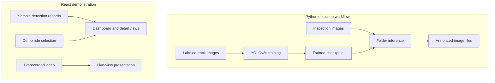

# Integrated Track Monitoring System

**Railway inspection prototype · YOLOv8 detection · React dashboard**

A computer-vision project for exploring railway track defect detection, paired with a dashboard for reviewing detections, devices, and maintenance workflows.

[Quick start](#quick-start) · [Detection workflow](#detection-workflow) · [Implementation status](#implementation-status) · [Architecture](#architecture-in-detail) · [Evaluation](#evaluation-and-reproducibility)

## Implementation status

| Component | Current scope |
| --- | --- |
| Detection training | YOLOv8s training script and 15-class dataset configuration |
| Image inference | Batch inference script that saves annotated images |
| Dashboard | React pages for detections, live-view presentation, tasks, devices, and reporting |
| Authentication | Mock Admin/Staff role selection in React context |
| Hardware and live integration | Not established by the committed training scripts and dashboard |

Dashboard screens and mock data demonstrate the intended workflow. They should not be presented as evidence of connected sensors, production authentication, or a deployed real-time inspection system.

## Quick start

```bash
git clone https://github.com/Praveenraj1618/Integrated-Track-Monitoring-System.git
cd Integrated-Track-Monitoring-System/frontend
npm install
npm start
```

Open http://localhost:3000. Use the available demo roles to explore the interface.

Build the frontend with `npm run build` from `frontend/`.

## Detection workflow

From the repository root, create and activate a Python virtual environment, then install the detection dependencies:

```bash
python -m venv .venv
```

Activate with `.venv\Scripts\Activate.ps1` on Windows PowerShell or `source .venv/bin/activate` on macOS/Linux.

```bash
python -m pip install ultralytics opencv-python numpy
```

### Training

1. Provide a YOLO-format dataset with image/label splits for training, validation, and testing.
2. Update [data.yaml](data.yaml) with paths to those splits.
3. Change `data_config_path` in [train_yolo.py](train_yolo.py); it currently points to a machine-specific Windows location.
4. Adjust `device`, batch size, and workers for your hardware. The committed configuration selects CUDA device 0 and batch size 32.
5. Run `python train_yolo.py`.

The script specifies YOLOv8s, 80 epochs, 640-pixel images, and early-stopping patience of 20. Results are written under `runs/train/`.

### Image inference

Edit `MODEL_PATH`, `IMAGE_FOLDER`, and `OUTPUT_FOLDER` in [val.py](val.py), then run:

```bash
python val.py
```

Despite its filename, this script performs folder-based inference and saves annotated images; it does not calculate validation metrics. Trained weights and the full training dataset must be supplied separately.

## Configured classes

The 15 labels in `data.yaml` are:

Cracks, Flakings, Joints, Shellings, Spallings, Squats, ballast_loss, broken_fishplate, corrosion, loose_bolt, missing_bolt, rail_joint_gap, rail_wear, sleeper_crack, and surface_spalling.

These are configured training categories; accuracy must be established using a trained checkpoint and a held-out dataset.

## Architecture in detail

The repository has two independently runnable parts: a Python detection workflow and a React demonstration interface.



There is no committed API connecting these two parts. The dashboard demonstrates how inspection results could be reviewed; the Python scripts perform training and image inference separately.

### Why object detection?

Track inspection needs both a defect category and its position. One photograph may contain several components or defects, so assigning one label to the whole image is insufficient. YOLO predicts bounding boxes, class labels, and confidence scores that can be overlaid on the original image.

Training begins with `yolov8s.pt` and adapts its weights to the configured dataset. Prediction confidence does not measure physical severity, crack depth, or track geometry.

### Dashboard behavior

| Screen or component | Current implementation |
| --- | --- |
| Dashboard overview | Reads `mockDetections`; several KPI values are hardcoded |
| Detection list | Shows sample labels, severity, status, and timestamps |
| Detection details | Provides a route for reviewing individual records |
| Live view | Plays `frontend/public/sample-video.mp4`; the button toggles UI state and randomly selects a severity badge |
| Login | Selects an in-memory Admin or Staff demo user |
| Report issue | Displays file, location, and description fields; no submission handler persists the report |
| Admin and task pages | Present the intended management workflow |

The displayed predictive risk score is a fixed interface value, not a trained model output. The stream control does not start a camera or run inference.

### Navigation

| Route | Purpose |
| --- | --- |
| `/` | Landing page |
| `/login` | Demo role selection |
| `/report` | Public report form |
| `/dashboard` | Overview |
| `/dashboard/detections` | Detection list |
| `/dashboard/detections/:id` | Detection details |
| `/dashboard/mytasks` | Maintenance task presentation |
| `/dashboard/admin` | Administrative interface |
| `/dashboard/settings` | Settings |

## Dataset and training details

Each image needs a corresponding text annotation file with the same filename stem. YOLO detection annotations use:

```text
class_id center_x center_y width height
```

Coordinates are normalized to the image dimensions. Class IDs are zero-based and must follow the label order in `data.yaml`.

| Split | Images | Labels |
| --- | --- | --- |
| Training | `train/images` | `train/labels` |
| Validation | `valid/images` | `valid/labels` |
| Test | `test/images` | `test/labels` |

Split inspection sequences or locations before training where possible. Adjacent video frames can be nearly identical, so distributing them randomly between training and evaluation can overstate performance.

### Committed configuration

| Setting | Value | Purpose |
| --- | --- | --- |
| Initial model | YOLOv8s | Transfer-learning starting point |
| Epoch limit | 80 | Maximum training passes |
| Image size | 640 | Training input size |
| Batch size | 32 | Images per optimization step |
| Device | 0 | First CUDA GPU |
| Workers | 4 | Data-loading processes |
| Patience | 20 | Early stopping after stalled improvement |
| Output group | `runs/train` | Training artifacts |
| Experiment | `rail_guard_experiment` | Run name; later runs may receive a suffix |

Batch size 32 does not guarantee compatibility with a particular GPU. Lower it if memory is exhausted. On Windows, reducing workers can help diagnose data-loading problems. Run `python check.py` to inspect PyTorch's CUDA visibility.

### Inference outputs

The inference script accepts JPG, JPEG, and PNG images and saves annotated results using the source filenames. Use a fresh output directory when comparing models to avoid replacing previous outputs.

Browse [saved prototype detections](prototype_results) and [prototype input images](proto_test) for qualitative examples. These images do not establish aggregate accuracy.

## Evaluation and reproducibility

Record the checkpoint, dataset split, class mapping, image size, confidence threshold, software environment, and hardware for each evaluation.

| Measure | Interpretation |
| --- | --- |
| Precision | Fraction of reported detections that match labeled defects |
| Recall | Fraction of labeled defects successfully found |
| mAP@50 | Detection ranking and localization at IoU 0.50 |
| mAP@50–95 | Detection quality across increasingly strict overlap thresholds |
| Per-class metrics | Performance differences between defect categories |
| Latency | Time required per image on the target hardware |

This documentation does not claim a reproduced score for the repository's 15-class configuration. `val.py` performs folder inference rather than metric calculation. Results from another dataset or class configuration should be reported separately.

## Demonstration guide

1. Start React and show the overview, detection list, and detail routes.
2. Explain which values and controls use sample data.
3. Show a saved annotated image.
4. With a compatible checkpoint available, run inference on a new image.
5. Explain how a future API would connect these results to the dashboard.

## Troubleshooting

| Symptom | Check |
| --- | --- |
| Dataset cannot be found | Replace the absolute Windows training path and verify split locations |
| CUDA unavailable | Inspect `check.py` and the PyTorch installation |
| GPU memory exhausted | Reduce batch size and close other GPU workloads |
| No inference output | Check the checkpoint, image folder, and supported extensions |
| Output directory creation fails | Ensure its parent exists; the script does not create every missing parent |
| Dashboard keeps showing sample values | The current frontend has no inference API connection |
| Report is not saved | The form has no persistence handler |

## Development roadmap

Proposed extensions, not completed capabilities:

1. Add an inference API that returns structured detections.
2. Persist images, detections, and maintenance status changes.
3. Replace mock dashboard records with API responses.
4. Connect camera input with timestamps and device identities.
5. Implement authenticated roles and report submission.
6. Add location/chainage and sensor integration, then measure synchronization and field performance.

## Project structure

| Path | Purpose |
| --- | --- |
| `frontend/src/pages/` | Dashboard and workflow pages |
| `frontend/src/components/` | Detection, device, map, chart, and layout components |
| `frontend/src/context/AuthContext.jsx` | Demo role state |
| `frontend/src/lib/mockData.js` | Dashboard sample data |
| `train_yolo.py` | Training configuration and entry point |
| `val.py` | Image-folder inference |
| `data.yaml` | Dataset split paths and class names |

## Technology and acknowledgments

Python and [Ultralytics YOLO](https://github.com/ultralytics/ultralytics) for detection; React, React Router, Tailwind CSS, Recharts, and Framer Motion for the dashboard.

Maintained by [Praveen Raj](https://github.com/Praveenraj1618). The earlier README referenced [Josh-1317's ITMS repository](https://github.com/Josh-1317/ITMS-Integrated-Track-Monitoring-System-); that reference is retained here for provenance, while setup commands point to this repository.
